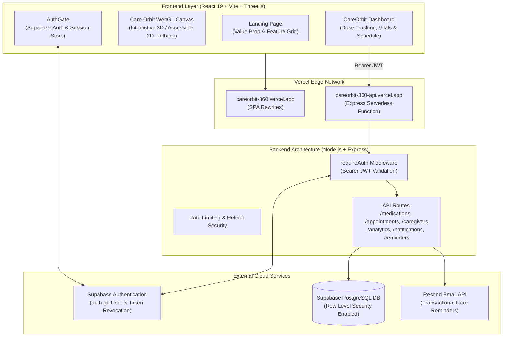

# CareOrbit 360 — Connected Care. Confident Living.

> **Prompt Wars Winning Edition** — An intelligent, accessible healthcare coordination and medication adherence platform designed for older adults, family caregivers, and clinical teams.

[](https://careorbit-360.vercel.app)
[](https://careorbit-360-api.vercel.app)
[](https://supabase.com)
[](https://www.typescriptlang.org/)

---

## 1. Live Deployment & Repository Links

- **Live Web Application**: [https://careorbit-360.vercel.app](https://careorbit-360.vercel.app)
- **Live Backend REST API**: [https://careorbit-360-api.vercel.app](https://careorbit-360-api.vercel.app)
- **GitHub Repository**: [https://github.com/anujpote17808/careorbit-360](https://github.com/anujpote17808/careorbit-360)
- **Latest Commit**: [`c878a163`](https://github.com/anujpote17808/careorbit-360/commit/c878a163) (`origin/master`)

---

## 2. The Problem & The Solution

### The Challenge
- **Senior Medication Non-Adherence**: 50% of chronic disease prescriptions are not taken as directed, causing avoidable emergency room visits.
- **Caregiver Anxiety**: Adult children and family members spend hours daily texting or calling elderly parents just to verify if morning doses were taken.
- **Fragmented Healthcare**: Multiple specialists, paper pill organizers, and forgotten clinical appointments create dangerous gaps in senior wellness.

### The CareOrbit 360 Solution
CareOrbit 360 bridges the gap with a unified, senior-accessible healthcare ecosystem:
1. **Interactive 3D Care Orbit**: A signature WebGL 3D visualization placing the patient at the center, surrounded by rotating, interactive care pillars (Medications, Appointments, Care Circle, Adherence Analytics, and Notifications).
2. **Senior-Accessible Medication Tracker**: Large high-contrast typography, single-touch dose confirmation, and duplicate dose prevention.
3. **Shared Family Care Circle**: Real-time activity feed where authorized family members and caregivers monitor medication adherence seamlessly.
4. **Clinical Appointments Agenda**: Specialist directory, calendar scheduling, preparation notes, and automated reminder emails.
5. **Emergency SOS Protocol**: High-visibility urgent trigger with audible 5-second countdown to eliminate false alarms and instant caregiver broadcast.

---

## 3. System Architecture



---

## 4. Key Features & Capabilities

| Feature | Description | Tech Stack |
| :--- | :--- | :--- |
| **Signature 3D Care Orbit** | Interactive WebGL canvas rendering concentric orbital planes with raycasted node selection, glowing connection auras, ambient particle fields, and an accessible 2D SVG fallback. | Three.js, WebGL, SVG |
| **Medication Management** | Full CRUD capabilities for prescriptions, scheduled dosage times, intake instructions, and idempotent dose logging (`medication_dose_logs`). | Express, Zod, Supabase |
| **Dynamic Adherence Analytics** | Real-time 7-day and 30-day compliance tracking with interactive bar charts, streak counts, and exportable patient reports. | Recharts, TypeScript |
| **Family Care Circle** | Multi-stakeholder directory with caregiver status, emergency contact flags, and real-time check-in activity timeline. | PostgreSQL, RLS |
| **Clinical Appointments** | Calendar and list view for specialist visits, clinic locations, and prep notes. | React, Lucide Icons |
| **Emergency SOS Safety Net** | Accessible emergency trigger with 5-second cancellation countdown and clear disclaimers. | Web Audio, Tailwind CSS |
| **Email Reminders** | Proactive caregiver and dose alert emails dispatched directly to inboxes. | Resend API |

---

## 5. Technology Stack

- **Frontend**: React 19, TypeScript 7, Vite 8, Tailwind CSS 4, Three.js 0.187, Lucide Icons, Recharts, Framer Motion.
- **Backend**: Node.js, Express 5, TypeScript 7, Zod, Helmet, CORS, Express-Rate-Limit, Serverless-HTTP.
- **Database & Auth**: Supabase PostgreSQL with Row Level Security (RLS) policies, Supabase Auth.
- **Email Delivery**: Resend API (`onboarding@resend.dev`).
- **Hosting & CI/CD**: Vercel (Production Web App & Production Serverless REST API).

---

## 6. Local Development Setup

### Prerequisites
- Node.js 20+
- npm 10+

### Clone & Install
```bash
# Clone the repository
git clone https://github.com/anujpote17808/careorbit-360.git
cd careorbit-360

# Install Backend Dependencies
cd backend
npm install

# Install Frontend Dependencies
cd ../frontend
npm install
```

### Environment Configuration

#### Backend (`backend/.env`)
```ini
PORT=3001
NODE_ENV=development
APP_ORIGIN=http://localhost:5173
SUPABASE_URL=https://<your-project>.supabase.co
SUPABASE_ANON_KEY=<your-anon-key>
SUPABASE_PUBLISHABLE_KEY=<your-publishable-key>
RESEND_API_KEY=<your-resend-api-key>
EMAIL_FROM=onboarding@resend.dev
```

#### Frontend (`frontend/.env`)
```ini
VITE_API_URL=http://localhost:3001
VITE_SUPABASE_URL=https://<your-project>.supabase.co
VITE_SUPABASE_PUBLISHABLE_KEY=<your-publishable-key>
VITE_SUPABASE_ANON_KEY=<your-anon-key>
```

### Running Locally
```bash
# Terminal 1: Start Backend API (runs at http://localhost:3001)
cd backend && npm run dev

# Terminal 2: Start Frontend Application (runs at http://localhost:5173)
cd frontend && npm run dev
```

### Running Automated Test Suite
```bash
cd backend && npm test
```
*Executes all 13 end-to-end integration and security tests against the live API and Supabase authentication.*

---

## 7. API Reference

All protected endpoints require `Authorization: Bearer <token>`.

| Method | Endpoint | Description | Status Code |
| :--- | :--- | :--- | :--- |
| `GET` | `/api/health` | Service health status | `200 OK` |
| `GET` | `/api/medications` | List user's active prescriptions | `200 OK` |
| `POST` | `/api/medications` | Create a new prescription | `201 Created` |
| `PUT` | `/api/medications/:id` | Update prescription dosage or schedule | `200 OK` |
| `DELETE` | `/api/medications/:id` | Deactivate prescription | `200 OK` |
| `POST` | `/api/medications/:id/dose` | Log dose status (`taken` / `missed`) | `200 OK` |
| `GET` | `/api/analytics/adherence` | Calculate today's adherence & 7-day trend | `200 OK` |
| `GET` | `/api/appointments` | List scheduled doctor visits | `200 OK` |
| `GET` | `/api/caregivers` | List care circle members | `200 OK` |
| `GET` | `/api/notifications` | List unread reminder notifications | `200 OK` |
| `POST` | `/api/reminders/send` | Dispatch medication email reminder | `200 OK` |

---

## 8. Two-Minute Judge Demo Workflow

1. **Step 1 — Landing Experience**: Navigate to [https://careorbit-360.vercel.app](https://careorbit-360.vercel.app). Observe the branding, value proposition (*"Connected Care. Confident Living."*), and the live WebGL 3D Care Orbit canvas rotating smoothly in the hero.
2. **Step 2 — Interactive 3D Orbit**: Hover over any orbiting node (Medications, Appointments, Care Circle) to view real-time HUD telemetry. Toggle between 3D and accessible 2D view.
3. **Step 3 — Instant Demo Access**: Click **"Explore Live Demo as Patient"** to enter Eleanor Vance's pre-loaded care dashboard without authentication friction.
4. **Step 4 — Medication Adherence**: In the Daily Care Snapshot, view active prescriptions. Click **"Mark as Taken"** beside Metformin ER. Observe the adherence progress bar and KPI cards update in real-time.
5. **Step 5 — 3D Studio Studio View**: Select the **"3D Care Orbit"** tab in the left sidebar to explore the full-screen interactive care visualization.
6. **Step 6 — Care Circle Coordination**: Switch to the **"Care Circle"** tab to review registered family members and the real-time check-in activity feed.
7. **Step 7 — Adherence Analytics**: Open **"Adherence Analytics"** to inspect the 7-day compliance chart and streak metrics.
8. **Step 8 — Emergency SOS**: Click **"Emergency SOS"** at the bottom of the sidebar. Observe the high-visibility emergency modal, countdown timer, and audible warning with zero false-alarm cancellation.

---

## 9. Disclaimer
CareOrbit 360 is a healthcare coordination and adherence platform. It does not provide medical diagnoses, alter physician prescriptions, or replace 911 / emergency medical services.
